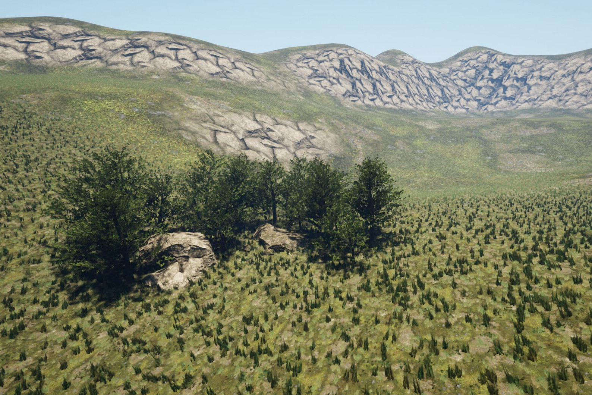
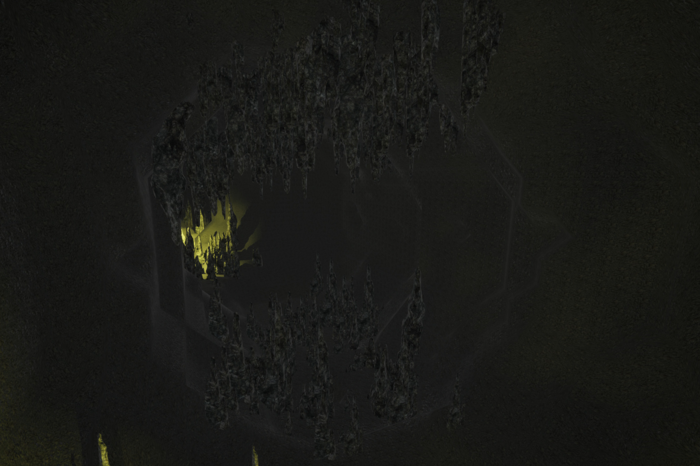
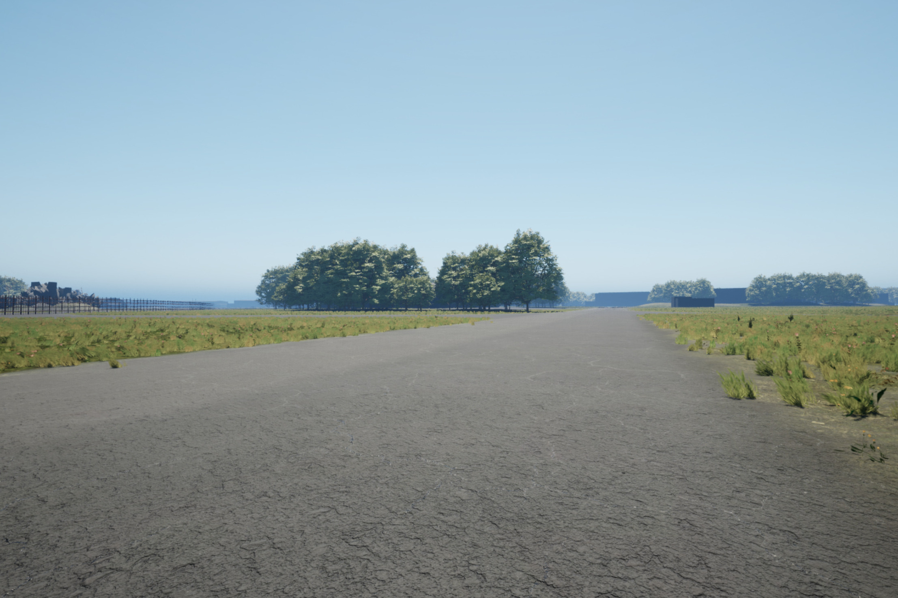
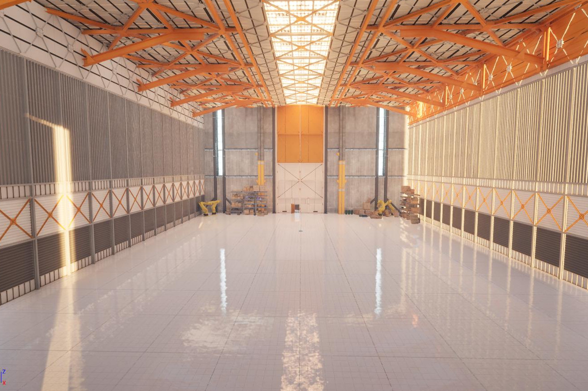
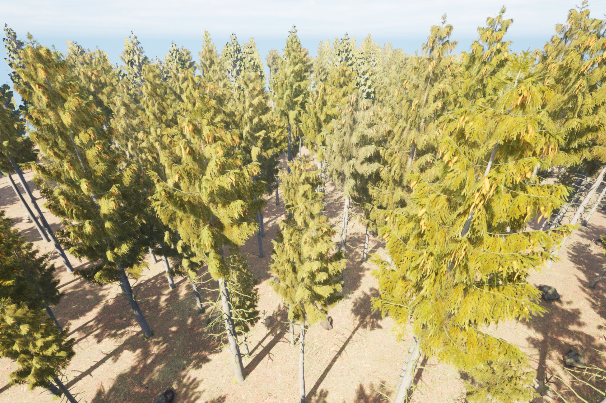

# MRS FlightForge Simulator


## Requirements

* A dedicated NVidia GPU (at least MX450, RTX is recommended) or a comparable AMD GPU
* 3 GB of HDD space

## The Maps

| Map Name  |                         | Map Name       |                               |
|-----------|-------------------------|----------------|-------------------------------|
| Valley    |     | Cave           |             |
| Forest    |     | Erding Airbase |   |
| Warehouse |  | Infinite forest |  |

## Controls

* `m`/`ESC` - show menu for switching graphics and worlds

## Installation

### Linux

1. Install the [MRS UAV System](https://github.com/ctu-mrs/mrs_uav_system/tree/ros2)
2. Install the MRS UAV System FlightForge endpoint
```bash
sudo apt install ros-jazzy-mrs-uav-flightforge-simulator
```
3. Download the and unpack [MRS FlightForge simulator](https://nasmrs.fel.cvut.cz/index.php/s/MnGARsSwnpeVy5z)
4. Launch the FlightForge Simulator by `./mrs_flight_forge.sh`. Alternatively, start it in a headless mode via `./mrs_flight_forge.sh -RenderOffscreen`.
6. Start the MRS UAV System FlightForge endpoint
```bash
cd /opt/ros/jazzy/share/mrs_uav_flightforge_simulator
./tmux/one_drone/start.sh
```

### Windows

Requirements:
* Windows 11 + updates
* WSL 2.0

1. Install Ubuntu 20.04 into the WSL 2.0 using the Microsoft Store
2. Install the [MRS UAV System](https://github.com/ctu-mrs/mrs_uav_system/tree/ros2) into WSL 2.0
3. Create `.wslconfig` file in `C:/Users/<User>/.wslconfig`
4. Place the following content into `.wslconfig`
```
[wsl2]
firewall=false
networkingMode=mirrored
debugConsole=false
[experimental]
hostAddressLoopback=true
```
5. Restart the WSL by issuing `wsl --shutdown` into a comand line.
6. Install the MRS UAV System FlightForge endpoint
```bash
sudo apt install ros-jazzy-mrs-uav-flightforge-simulator
```
7. Download and unpack the [FlightForge Simulator](https://nasmrs.felk.cvut.cz/index.php/s/MnGARsSwnpeVy5z)
8. Start the FlightForge Simulator
9. Start the MRS UAV System FlightForge endpoint
```bash
cd /opt/ros/jazzy/share/mrs_uav_flightforge_simulator
./tmux/one_drone/start.sh
```
10. The first start might require hitting "CTRL+C" in the `roscore` tab of the tmux session. The roscore is always stuck for the first time after rebooting the computer.

## Connecting to the simulator

The node reaches the simulator on one TCP port, `simulator_port` (8600 by default), at `simulator_ip`; every UAV and sensor goes through it. It needs a simulator speaking API 1.x and shuts down, naming both versions, if the major version differs.

## Frames and units

- The world frame is right-handed with z up, metres, and z = 0 on the floor under the level's spawn point. UAV spawn positions, poses and scene files use it.
- Sensor mounts (`offset` in metres, `rotation` as roll, pitch and yaw in degrees) are relative to `<uav>/fcu`, x forward, y left, z up. Cameras look along the mount's x; their images are in the optical frame of the published TF.
- Lidar points are in metres in the lidar's frame. `points_free` holds unit directions of the rays without a return; a Livox scan has no beam grid, so for it `points_free` stays empty.
- The rangefinder measures along its frame's x and publishes metres, `+inf` when nothing is in range.
- Every stamp is simulated time.

## Time models

The ROS node has two ways of keeping the simulator and ROS time together, chosen with `time_model` in the config:

- **`lockstep`**: the node owns time. It steps the simulator, then fetches every sensor that is due and waits for them before the next step. Sensor rates are exact in simulated time and every frame belongs to a known step, so results repeat. Wall-clock speed is whatever the GPU allows, up to `realtime_factor`.
- **`free_running`** (default): the simulator runs on its own and the node paces ROS time from its frame rate with `dynamic_rtf`. Closer to real time on a loaded machine, but cameras deliver what the frame rate allows, not always their configured `rate`.

In lockstep the simulator advances on a grid: every physics step if a sensor runs at `simulation_rate`, otherwise as coarsely as the fastest sensor allows, and never below 30 Hz. A sensor's rate holds on average, with its stamps on grid points. Raise `simulation_rate` for a finer grid.

## Ground, landing and crashes

- `ground/enabled: true` and `ground/from_simulator: true` (default): each UAV's ground is the highest surface FlightForge finds straight below the centre and the corners of its footprint (a square of half-side `arm_length`), asked for every UAV in one request on its own connection, at most once per simulation step (API 1.1). The node spawns each UAV on the surface under its spawn point and keeps the height the simulator rested it at, so it lands where its airframe touches: floors, boxes, rooftops, terrain. Where nothing is below, there is no ground.
- `ground/from_simulator: false`: the dynamics' flat ground at `ground/z`. `ground/enabled: false`: no ground at all.
- `individual_takeoff_platform/enabled` holds a UAV at its spawn height until its thrust passes 90 % of hover; with the ground from the simulator it only matters for a spawn in the air.
- With `collisions/enabled` and `collisions/crash`, a UAV crashes when it meets the ground faster than `collisions/max_touchdown_speed` (2 m/s by default), and on any collision the simulator reports other than touching the ground under it (no more than 5 cm above it) at most that fast.
- The ground from the simulator needs `UavSystemRos::setGroundZ()` from `mrs_multirotor_simulator`, which is not upstream yet.

## Device presets

Real sensors come from the simulator's device library, with their datasheet parameters, mounting offsets and housing meshes. Add them under `devices` in your custom config:

```yaml
mrs_uav_flightforge_simulator:
  devices:
    n_devices: 2
    device_0:
      type: "livox_mid360"
      offset: {x: 0.0, y: 0.0, z: 0.12}
    device_1:
      type: "realsense_d435i"
      offset: {x: 0.2, y: 0.0, z: 0.0}
      rotation: {pitch: 15.0}
```

| `type` | Sensors | Roles |
|---|---|---|
| `livox_mid360` | non-repetitive 360x59 deg lidar, 40 m | `lidar` |
| `livox_avia` | non-repetitive 70x77 deg lidar, 190 m | `lidar` |
| `ouster_os0_32` | 32 channels, 1024 columns, 90 deg vertical, 50 m | `lidar` |
| `ouster_os1_64` | 64 channels, 1024 columns, 45 deg vertical, 120 m | `lidar` |
| `odin1` | 120x90 deg solid-state lidar, 70 m, and a 173 deg fisheye, 1600x1296 | `lidar`, `fisheye` |
| `realsense_d435i` | 5 cm stereo pair, 848x480, and RGB, 1280x720 | `stereo`, `rgb` |

Topics are `/<uav>/<type>_<k>/<role>/...`, for example `/uav1/livox_mid360_0/lidar/points` or `/uav1/realsense_d435i_0/stereo/left/image_raw`, and TF frames `<uav>/<type>_<k>_<role>`. `k` counts devices of the same type. The offset places the base of the housing.

Lidars keep the device's rate unless `lidar_rate` is set, and cameras run at `camera_rate`. The other keys are in the `devices` block of `config/flightforge_simulator.yaml`. The Odin1 camera renders six faces at full resolution, so it is the most expensive one to run; lower its `camera_rate` if the simulator slows down.

## Scenes

`scene_files` lists YAML files of objects to place when the simulator starts, in the same frame as the UAVs: metres and degrees, right-handed, z = 0 on the floor. The simulator's `export_scene` writes this format.

```yaml
objects:
  - asset: /Engine/BasicShapes/Cube
    position: [5.0, 0.0, 0.5]
    orientation: [0.0, 0.0, 45.0] # roll, pitch, yaw
    scale: 0.5
```

`asset` is a bare name, a `/Game` or `/FlightForgePlugin` object path, or the path of a `.glb`. A file can set `search_paths` for bare names and `model_paths` for glTF directories. Objects placed earlier are removed first, so restarting the node does not double them.

### Object libraries

`libraries` lists object libraries to load on the simulator's machine, each a directory of `.glb` files or a manifest:

```yaml
name: clgp
objects:
  - id: trash_can/001055c2
    asset: objaverse/glbs/001055c2.glb # relative to this file, or a /Game path
    class: trash_can
    scale: 0.6 # what brings the model to real size
    height: 0.6 # [m]
    base_z: 0.5 # [m] at scale 1, how far the model's origin sits above its lowest point
    thumbnail: thumbs/trash_can/001055c2.png
```

A scene names an object as `lib:<library>/<id>`. It arrives at the library's scale unless the entry sets `scale`, and its `position` is the base of the object, so `z: 0` stands it on the floor.

## Citing this work

If you use this simulator in your research, please cite the following paper:

```@article{čapek2025flightforge,
  title   = {FlightForge: Advancing UAV Research with Procedural Generation of High-Fidelity Simulation and Integrated Autonomy},
  author  = {David Čapek and Jan Hrnčíř and Tomáš Báča and Jakub Jirkal and Vojtěch Vonásek and Robert Pěnička and Martin Saska},
  year    = {2025},
  journal = {arXiv preprint arXiv: 2502.05038},
  url     = {https://arxiv.org/abs/2502.05038v1},
  pdf     = {https://arxiv.org/pdf/2502.05038.pdf}
}
```

## Planned features

* Adding back a grayscale normalized depth image
* possible coloring of the depth pointcloud using the segmented RGB image
